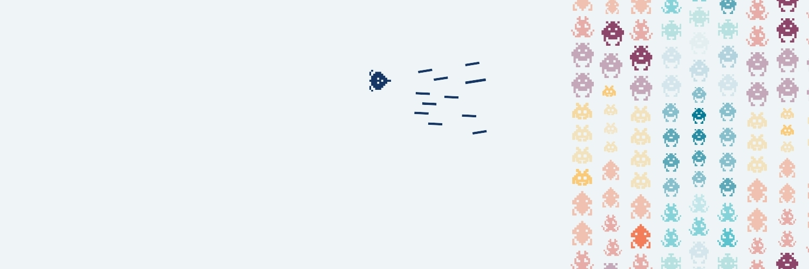

<p align="left">
  <picture>
    <source media="(prefers-color-scheme: dark)" srcset=".github/assets/readme-banner_dark.jpg" />
    
  </picture>
</p>

# LINEAR AGENTS

**REVREBEL's Linear-to-local-agent integration.** Four independently installed Linear app agents each use a Cloudflare Worker for OAuth, authenticated webhooks, initial Agent Session activity and completion callbacks. Workers forward jobs over Cloudflare Tunnel to a local machine.

> **Repository status:** The canonical hostname router is now checked in at [`.linear-agent-bridge/agent-bridge.mjs`](.linear-agent-bridge/agent-bridge.mjs). The older `chatgpt-bridge.mjs` and `bridge_daemon.py` receivers have been retired. The Antigravity Python runner `run_agent.py` remains at the repository root and may still need to be referenced via `RUN_AGENT_PATH` on the deployed Mac.

## Architecture

```text
Linear (AgentSessionEvent)
  |  signed webhook
  v
linear-<agent>.revrebel.io          Cloudflare Worker
  |  OAuth token in LINEAR_DATA KV
  |  acknowledge Linear via agentActivityCreate ("thought")
  |  append session-specific /complete command
  |  POST /jobs with shared bearer authentication
  v
<agent>-agent.revrebel.io           Cloudflare Tunnel
  |
  v
127.0.0.1:8788                     Local bridge
  |  save job + dispatch local CLI (depending on deployed bridge)
  v
Antigravity / Trae / Gemini CLI / ChatGPT file handoff
  |
  +--> POST https://linear-<agent>.revrebel.io/complete
       Worker issues final "response" or "error" Agent Activity
```

| Agent | Worker directory | Worker hostname | Tunnel hostname |
|---|---|---|---|
| Antigravity | `linear-antigravity-worker/` | `linear-antigravity.revrebel.io` | `antigravity-agent.revrebel.io` |
| Trae | `linear-trae-worker/` | `linear-trae.revrebel.io` | `trae-agent.revrebel.io` |
| Gemini CLI | `linear-gemini-worker/` | `linear-gemini.revrebel.io` | `gemini-agent.revrebel.io` |
| ChatGPT | `linear-chatgpt-worker/` | `linear-chatgpt.revrebel.io` | `chatgpt-agent.revrebel.io` |

## Repository

```text
README.md
docs/
  AGENT_BRIDGE_ARCHITECTURE_AND_OPERATIONS.md
linear-antigravity-worker/
linear-trae-worker/
linear-gemini-worker/
linear-chatgpt-worker/
.linear-agent-bridge/
  agent-bridge.mjs      # canonical multi-agent local router
  .trae/               # Trae session-start integration
run_agent.py             # Antigravity CLI runner
```

Each Worker has its own `wrangler.jsonc`, `src/index.ts`, and package configuration. The shared source is duplicated between Worker folders, so a fix in one does **not** automatically reach the others.

## Setup overview

1. Create a distinct Linear OAuth app for each agent, with an exact callback of `https://linear-<agent>.revrebel.io/oauth/callback`, webhook `https://linear-<agent>.revrebel.io/webhook`, Agent session events enabled, and `actor=app` scopes `read,write,app:assignable,app:mentionable`.
2. Set a unique Cloudflare Worker custom domain for each app. Do **not** route Worker hostnames to Tunnel.
3. Configure a Worker KV namespace bound as **`LINEAR_DATA`** in every Worker. The physical namespace ID can differ for each agent.
4. Configure `SERVICE_NAME`, `LINEAR_REDIRECT_URI`, `LINEAR_SCOPES` and `BRIDGE_URL` in its `wrangler.jsonc`.
5. Set Worker secrets `LINEAR_CLIENT_ID`, `LINEAR_CLIENT_SECRET`, `LINEAR_WEBHOOK_SECRET`, `BRIDGE_SHARED_SECRET`. Never commit their values.
6. Configure Tunnel hostname `<agent>-agent.revrebel.io` to the Mac listener on `http://127.0.0.1:8788`. Ensure the actual deployed bridge routes by hostname.
7. From the target Worker directory, run `npm install` and `npx wrangler deploy`, then open `https://linear-<agent>.revrebel.io/install` to complete OAuth.
8. Delegate a non-destructive test issue, verify initial Agent Activity, local delivery, agent acknowledgment and authenticated completion.

Example checks (substitute the correct agent):

```bash
curl -i https://linear-trae.revrebel.io/health
curl -i https://linear-trae.revrebel.io/install
curl -i https://linear-trae.revrebel.io/oauth/callback
cd linear-trae-worker && npx wrangler tail
```

The bare OAuth callback should return a 400 for missing code/state. `/install` should redirect to Linear. Do not publish shared secrets or OAuth authorization codes from log output.

## Worker HTTP routes

| Method and path | Purpose |
|---|---|
| `GET /` | App landing and install link |
| `GET /health` | Worker health |
| `GET /install` | Initiate app OAuth |
| `GET /oauth/callback` | Exchange code and store installation |
| `POST /webhook` | Signature-check and process Linear events |
| `POST /complete` | Authenticated terminal Agent Activity |

**Completion is not the same as issue status:** `/complete` emits a terminal Agent Activity, but the current Worker does not automatically update the Linear issue's workflow status to Done. The agent must update the issue separately.

**Completion authentication:** the injected curl uses `$BRIDGE_SHARED_SECRET`, which must actually exist in the executing agent's environment. Missing shell expansion produces a 401; do not paste a live secret into an issue.

## Local service

The canonical local router is [`.linear-agent-bridge/agent-bridge.mjs`](.linear-agent-bridge/agent-bridge.mjs). It listens on `127.0.0.1:8788` and routes by Tunnel `Host` header. Antigravity launches `RUN_AGENT_PATH` with Python, Trae launches its configured CLI, Gemini supports headless mode or a Warp interactive launch, and ChatGPT saves the job for external handling. Configure `RUN_AGENT_PATH` to point to the actual deployed `run_agent.py` location; the repository keeps that Python file at its root.

## Documentation

See **[Architecture & Operations](docs/AGENT_BRIDGE_ARCHITECTURE_AND_OPERATIONS.md)** for design decisions, installation, OAuth flow, observed failures, security caveats, operational checks, and prioritized code-review findings.

---

REVREBEL · [revrebel.io](https://revrebel.io)
